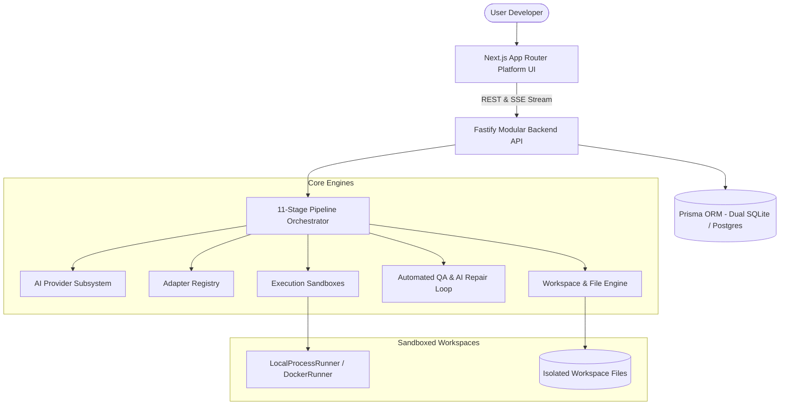

# Universal AI App Builder - Architecture Documentation

## 1. System Overview

**Universal AI App Builder** is an autonomous software development platform designed to translate high-level natural language application specifications into fully functioning, verified, compiled, and runnable full-stack software products.

---

## 2. The 11-Stage AI Pipeline

1. **Stage 1 — Requirement Analysis:** Synthesizes user prompts into structured user stories, functional capabilities, and constraints (documented in `docs/PRD.md`).
2. **Stage 2 — Architecture Planning:** Generates architecture blueprints, component manifests, module boundaries, and API contracts (documented in `docs/ARCHITECTURE.md`).
3. **Stage 3 — Project Scaffolding:** Establishes root manifests, compiler configurations (`tsconfig.json`, `.csproj`), package definitions, and `docker-compose.yml`.
4. **Stage 4 — Database Generation:** Constructs database context (`AppDbContext`), data models (`Product`, `User`, `StockMovement`), constraints, and initial seed data.
5. **Stage 5 — Backend Generation:** Produces REST API controllers, endpoints, DTOs, route handlers, error wrappers, and OpenAPI definitions.
6. **Stage 6 — Frontend Generation:** Builds responsive user interfaces, dashboard pages, tables, analytics cards, and API clients.
7. **Stage 7 — Integration:** Matches API contracts, CORS headers, environment variables, and proxy routing.
8. **Stage 8 — Automated Quality Assurance:** Validates syntax, type safety, automated tests, and build artifacts.
9. **Stage 9 — AI Repair Loop:** If errors are detected, the system categorizes the error, diagnoses root causes, generates targeted diffs, and re-verifies automatically.
10. **Stage 10 — Build & Run:** Allocates a collision-free port, spawns isolated processes, runs health check validation, and establishes live preview URLs.
11. **Stage 11 — Delivery:** Packages project files into downloadable ZIP archives and creates immutable checkpoints.

---

## 3. Security Isolation Layers

- **PathGuard Protection:** All file operations are checked to prevent path traversal attempts (`../`) escaping the workspace.
- **Command Allowlisting:** Executables are strictly validated against an approved allowlist (`npm`, `node`, `dotnet`, `python`, `git`, `docker`). Shell operators like `;`, `&`, `|`, and dangerous commands are blocked.
- **Secret Encryption:** API keys and credentials are encrypted using AES-256-GCM with authenticated tags and random IVs.
- **Dynamic Port Allocation:** Ports are dynamically verified and bound within 5100-5999 to prevent port collision between multiple running projects.

